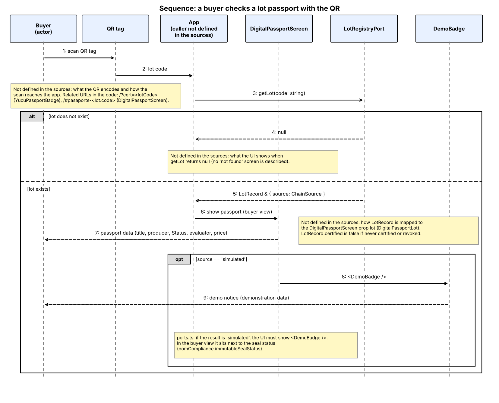

# Sequence diagram: a buyer checks a lot passport with the QR

This diagram shows what happens when a buyer scans the QR tag of a product and the app looks up the lot with `LotRegistryPort.getLot`.
It covers the case where the lot does not exist (`getLot` returns `null`) and the case where the data is simulated (`source: 'simulated'`), which requires `<DemoBadge />`.
Anything the sources do not define (what the QR encodes, which component calls `getLot`, what the UI shows for a missing lot) is written as a note in the diagram.

## Elements

| Element | Type | Description |
|---|---|---|
| Buyer | Actor | The person who scans the QR tag and sees the passport. |
| QR tag | Participant | The physical tag of the product. |
| App | Participant | The caller of `getLot`. The sources do not define which component it is. |
| `DigitalPassportScreen` | Participant (class) | Screen that shows the passport; it has a buyer view (`'comprador'`). |
| `LotRegistryPort` | Participant (interface) | Port that exposes `getLot`. |
| `DemoBadge` | Participant (component) | Badge `<DemoBadge />` shown when the data is simulated. |
| `getLot(code)` | Method | `LotRegistryPort.getLot(code: string)`. |
| `LotRecord & { source: ChainSource }` | Return value | Result when the lot exists. |
| `null` | Return value | Result when the lot does not exist. |
| `source: 'simulated'` | State | `ChainSource` value (`'testnet'` or `'simulated'`) that requires `<DemoBadge />`. |
| `alt [lot does not exist]` / `[lot exists]` | Fragment | Two alternative results of `getLot`. |
| `opt [source == 'simulated']` | Fragment | Optional step when the data is simulated. |

## Sources

- `src/core/chain/ports.ts`
- `src/components/DigitalPassportScreen.tsx`
- `src/components/YucuPassportBadge.tsx`
